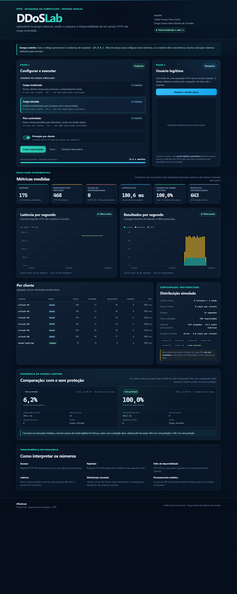

# DDoSLab

**Laboratório educacional de indisponibilidade HTTP e mitigação por limite de taxa**

Projeto final (entrega parcial) da disciplina **Segurança da Computação** da
**Universidade Federal da Paraíba (UFPB)**.

**Equipe**

- Ivaldo Pureza Freire Júnior
- Diogo Soares Alves Barreto de Carvalho

## Prévia do painel



---

## 1. Objetivo

O DDoSLab é um laboratório local que permite observar, de forma controlada, como
uma carga concorrente pode degradar a disponibilidade de um serviço HTTP. O
projeto combina:

- um servidor HTTP funcional com capacidade de processamento intencionalmente
  limitada;
- uma interface que representa um usuário legítimo acessando o serviço;
- clientes virtuais que geram requisições reais em loopback;
- um limitador de taxa real, por cliente, que pode ser ligado ou desligado;
- um painel com métricas medidas em tempo real;
- uma comparação entre a experiência legítima com e sem proteção.

O foco é **demonstrar e medir**, não simular números. Todas as latências e
contagens exibidas são coletadas durante as requisições. O que é sintético
(quantidade de clientes virtuais, taxa configurada, pausa de processamento) é
identificado como configuração do experimento, nunca como resultado.

> **Escopo ético e de segurança:** o laboratório escuta apenas em
> `127.0.0.1` e sempre envia tráfego para o próprio servidor local. Não existe
> campo de alvo, host, IP ou URL externa. Os cenários têm limites rígidos de
> concorrência, volume e duração definidos no servidor. O projeto não deve ser
> adaptado para atingir sistemas de terceiros.

---

## 2. O que foi entregue nesta parcial

- Servidor Flask funcional em Python.
- Serviço HTTP com limite de concorrência e processamento sintético.
- Painel web em pt-BR com visualização em tempo real.
- Três cenários fixos de carga, todos dentro de limites globais.
- Clientes virtuais reais, executados como threads locais.
- Sonda legítima automática a cada segundo.
- Simulador de usuário legítimo no navegador (botão de acesso real).
- Limitador de taxa por cliente com algoritmo de balde de fichas.
- Métricas de sucesso, rejeição, falha de disponibilidade e latência p50/p95.
- Gráficos de latência e de resultados por segundo em canvas.
- Comparação automática da última execução com proteção contra a última sem
  proteção.
- Controles de iniciar, parar e reiniciar.
- Testes automatizados, incluindo integração com servidor HTTP real.
- Esta documentação.

---

## 3. Como executar

### Requisitos

- Python 3.11 ou superior (validado com Python 3.13).
- Flask 3.x.
- pytest para os testes.
- Nenhum banco de dados, autenticação, serviço externo ou dependência de
  front-end.

### Windows (PowerShell)

```powershell
python -m venv .venv
.\.venv\Scripts\Activate.ps1
python -m pip install --upgrade pip
python -m pip install -r requirements.txt
python app.py
```

### Linux ou macOS

```bash
python3 -m venv .venv
source .venv/bin/activate
python -m pip install --upgrade pip
python -m pip install -r requirements.txt
python app.py
```

Abra o painel em:

```text
http://127.0.0.1:5000
```

O terminal deve ser mantido aberto durante a apresentação. Para encerrar o
servidor, use `Ctrl+C`.

### Testes

```bash
python -m pytest
```

A suíte cobre o limitador, as métricas, a capacidade, as rotas e um experimento
completo com servidor HTTP real em uma porta livre do loopback.

---

## 4. Roteiro de demonstração

1. Abra o painel em `http://127.0.0.1:5000`.
2. Selecione **Carga elevada**.
3. Deixe **Proteção por cliente** desligada e clique em **Iniciar experimento**.
4. Durante os 15 segundos, clique algumas vezes em **Acessar o serviço agora**.
   O painel mostrará respostas 200, 503 e latência medida pelo navegador.
5. Ao terminar, observe a taxa de sucesso da sonda legítima, as falhas de
   disponibilidade e o gráfico de latência.
6. **Não clique em Reiniciar.** Clique em **Iniciar experimento** novamente,
   agora com **Proteção por cliente** ligada.
7. Ao final da segunda execução, a seção **Comparação: com e sem proteção**
   mostrará os dois resultados lado a lado, usando a execução mais recente de
   cada configuração.
8. Use **Reiniciar laboratório** somente quando quiser apagar métricas,
   comparação e histórico em memória.

> O botão **Parar** encerra a carga e preserva os resultados. O botão
> **Reiniciar laboratório** apaga tudo. Entre as duas execuções comparativas,
> use apenas **Iniciar**; não reinicie o laboratório.

### Exemplo de resultado observado na validação local

Os valores abaixo são **medições reais de uma execução de validação**, não
constantes do sistema. Eles variam com a máquina, com processos em segundo plano
e com o sistema operacional.

Cenário **Carga elevada** (6 clientes virtuais, 8 req/s por cliente, 15 s),
executado em loopback com concorrência máxima 4 e processamento sintético de
180 ms:

| Condição | Sucesso da sonda legítima | Falhas da sonda | p95 da sonda | Rejeições 429 | Falhas 503 |
| --- | ---: | ---: | ---: | ---: | ---: |
| Sem proteção | 6,2% | 15 de 16 | 180,1 ms | 0 | 250 |
| Com proteção | 100,0% | 0 de 15 | 180,5 ms | 468 | 0 |

A comparação é gerada a partir dessas amostras medidas. Em uma execução
protegida, o limitador rejeita rapidamente o excesso de requisições de cada
cliente virtual (HTTP 429), preservando vagas de processamento para a sonda
legítima. Sem proteção, as requisições disputam as mesmas vagas e o serviço
responde 503 quando a capacidade está ocupada.

---

## 5. Arquitetura

```text
┌──────────────────────────── Navegador ────────────────────────────┐
│  painel HTML/CSS/JS          botão de usuário legítimo            │
└───────────────┬──────────────────────────────┬────────────────────┘
                │ /api/estado (polling 1 s)    │ /api/servico
                ▼                              ▼
┌──────────────────────────── Flask local 127.0.0.1:5000 ───────────┐
│  rotas do painel                                                   │
│  /api/experimento/iniciar | /api/experimento/parar                │
│  /api/laboratorio/reiniciar                                        │
│  /api/servico  ──►  limitador por cliente  ──►  capacidade (4)    │
│                          │                          │              │
│                          └────────► métricas ◄──────┘              │
│  ExperimentManager: threads de clientes virtuais + sonda legítima  │
└────────────────────────────────────────────────────────────────────┘
          ▲                                      ▲
          │ HTTP real em loopback                │ HTTP real em loopback
          │                                      │
   clientes virtuais (threads)            sonda legítima automática
```

### Módulos

| Arquivo | Responsabilidade |
| --- | --- |
| `app.py` | Ponto de entrada e execução do servidor. |
| `ddoslab/__init__.py` | Fábrica da aplicação, injeção de dependências e cabeçalhos de segurança. |
| `ddoslab/config.py` | Cenários fixos, limites e parâmetros do laboratório. |
| `ddoslab/capacity.py` | Semáforo de capacidade e pausa de processamento sintético. |
| `ddoslab/rate_limit.py` | Balde de fichas e registro de limitadores por cliente. |
| `ddoslab/metrics.py` | Agregação thread-safe, percentis e série temporal. |
| `ddoslab/experiment.py` | Início, parada, carga virtual, sonda legítima e comparação. |
| `ddoslab/web.py` | Rotas HTML e API. |
| `ddoslab/templates/index.html` | Painel em pt-BR. |
| `ddoslab/static/css/estilo.css` | Estilo responsivo. |
| `ddoslab/static/js/painel.js` | Polling, controles, gráficos em canvas e acesso legítimo. |
| `tests/` | Testes unitários e de integração. |

---

## 6. Como o experimento funciona

### 6.1 Serviço limitado

O endpoint `/api/servico` é o recurso compartilhado por todos os participantes.
A capacidade é um `BoundedSemaphore` com **4 vagas simultâneas**. Quando uma
requisição não obtém uma vaga imediatamente, recebe **HTTP 503**; não há fila
ilimitada.

Quem obtém a vaga executa uma pausa de **180 ms** para representar trabalho de
CPU/IO. Essa pausa é deliberadamente sintética e identificada na interface como
“processamento simulado”. Ela mantém a demonstração segura e evita esgotar a
máquina real.

### 6.2 Clientes virtuais

Cada cliente virtual é uma thread local que faz requisições HTTP reais para
`127.0.0.1:5000/api/servico`, com um identificador no cabeçalho
`X-DDoSLab-Client`. A thread respeita a taxa e o volume do cenário; se uma
resposta demorar, ela não tenta compensar o atraso com uma rajada.

O escalonamento inicial dos clientes é distribuído dentro de um ciclo do
limitador para evitar que todos enviem ao mesmo tempo e distorçam a comparação.

### 6.3 Usuário legítimo

Há duas representações:

- **Sonda legítima automática:** thread que faz uma requisição por segundo ao
  serviço, com o identificador `sonda-legitima`. Ela produz a amostra
  comparável entre execuções.
- **Usuário legítimo manual:** botão no navegador que faz um `fetch` real para
  `/api/servico` e mede o tempo de ida e volta com `performance.now()`.

Ambos disputam a mesma capacidade do serviço. A sonda não recebe prioridade
artificial.

### 6.4 Limitador de taxa

O limitador usa **balde de fichas por cliente**:

- taxa: **2 requisições por segundo por cliente**;
- rajada inicial: **1 ficha**;
- recarga contínua proporcional ao tempo;
- ao exceder, o cliente recebe **HTTP 429** com `Retry-After`;
- ao desligar a proteção, nenhuma ficha é consumida e todas as requisições
  seguem para a capacidade.

O identificador do cliente é o cabeçalho de laboratório quando a conexão vem de
`127.0.0.1`; caso contrário, é derivado do endereço remoto. O papel
(`virtual` ou `legitimo`) é resolvido pelo cadastro interno do experimento, não
por um campo de resultado enviado pelo painel.

A proteção é escolhida **antes** de cada execução e o controle fica bloqueado
durante a carga. Isso evita que ligar/desligar o limitador no meio de uma
execução contamine a comparação entre os dois cenários.

### 6.5 Métricas

Todas as métricas são registradas no servidor quando a resposta é produzida,
exceto falhas de transporte, que são registradas no cliente que não recebeu
resposta.

| Métrica | Definição |
| --- | --- |
| Sucesso | HTTP 200 após ocupar uma vaga. |
| Rejeitado | HTTP 429 do limitador de taxa do cliente. |
| Falha de capacidade | HTTP 503 por ausência de vaga. |
| Falha de transporte | Exceção de conexão/timeout sem resposta HTTP. |
| Latência | Tempo do handler até a resposta 200, em ms. |
| p50 / p95 | Percentis das amostras de latência bem-sucedidas. |
| Série temporal | Contagens e latências agregadas por segundo, janela de 60 s. |
| Sonda legítima | Subconjunto de métricas do cliente `sonda-legitima`. |

A taxa de sucesso, a taxa de rejeição e a taxa de falha são derivadas das
contagens medidas. Nenhuma latência é inventada ou estimada pelo front-end.

---

## 7. Limites fixos

| Recurso | Limite |
| --- | ---: |
| Endereço de escuta | `127.0.0.1:5000` |
| Concorrência de processamento | 4 requisições |
| Processamento sintético | 180 ms |
| Taxa por cliente | 2 req/s |
| Rajada por cliente | 1 requisição |
| Clientes virtuais por cenário | até 8 |
| Taxa máxima por cliente virtual | 10 req/s |
| Duração máxima | 20 s |
| Volume planejado máximo | 1600 requisições |

### Cenários

| Cenário | Clientes | Taxa por cliente | Duração | Volume planejado |
| --- | ---: | ---: | ---: | ---: |
| Carga moderada | 4 | 4 req/s | 10 s | 160 |
| Carga elevada | 6 | 8 req/s | 15 s | 720 |
| Pico controlado | 8 | 10 req/s | 20 s | 1600 |

O volume planejado é uma configuração do gerador. O volume realmente realizado
pode ser menor porque cada cliente envia requisições sequencialmente e não
compensa atrasos com rajadas. O painel mostra as respostas efetivamente
contabilizadas, não o planejado.

---

## 8. Conceitos de segurança abordados

- **Disponibilidade** como um dos pilares da tríade CIA.
- **Exaustão de recursos** e **esgotamento de pool de concorrência**.
- **Ataques volumétricos e de aplicação (L7)**, no recorte educacional de
  requisições HTTP repetidas.
- **Rate limiting** e **token bucket** como mitigação de aplicação.
- **Backpressure:** recusar rapidamente com 503 em vez de enfileirar sem limite.
- **Separação entre 429 e 503:** o primeiro é uma decisão de política; o segundo
  é indisponibilidade por capacidade.
- **Observabilidade:** latência, contadores, percentis, janela temporal e
  comparação antes/depois.
- **Escopo e superfície de ataque:** bind em loopback, ausência de alvo
  configurável e limites impostos no servidor.
- **Fronteira de confiança:** o cabeçalho de identificação dos clientes
  virtuais é aceitável somente neste laboratório local; ele não é autenticação
  e não deve ser usado como controle de segurança em produção.
- **Defesa em profundidade:** validação de payload, limite de corpo, CSP,
  cabeçalhos `nosniff`, `DENY` e `no-referrer`, ausência de HTML/JS inline e
  exigência de JSON nas ações de estado.
- **Controle de ações locais:** iniciar, parar e reiniciar exigem
  `Content-Type: application/json`, o que evita o disparo por formulários
  simples de páginas externas. Isso não substitui autenticação.

---

## 9. Limitações atuais

1. **Todos os clientes estão no mesmo host e processo.** A “distribuição” é
   lógica (threads e identificadores), não uma rede distribuída real.
2. **A carga usa loopback.** Não há latência WAN, perda de pacotes, NAT ou
   firewalls.
3. **O processamento é sintético** (`sleep` de 180 ms), não consumo real de CPU,
   memória ou disco.
4. **O servidor de desenvolvimento do Flask** é adequado à demonstração, mas não
   é um servidor de produção.
5. **O GIL e o agendamento do sistema operacional** influenciam os resultados.
   Números variam entre máquinas e execuções.
6. **O identificador de cliente virtual é um cabeçalho** e pode ser falsificado
   por qualquer processo local. O papel é resolvido pelo experimento, mas não há
   autenticação.
7. **Não há persistência.** Métricas e comparações ficam em memória e são
   perdidas ao encerrar o processo. As ações de controle também não têm
   autenticação: qualquer processo local pode chamá-las, desde que use JSON.
8. **A proteção cobre apenas L7 HTTP e um limitador por cliente.** Não há
   mitigação de L3/L4, SYN flood, slowloris ou múltiplas camadas.
9. **O limitador é fixo e igual para todos.** Não há priorização de usuários
   legítimos, reputação, listas de bloqueio ou limite adaptativo.
10. **O painel usa polling de 1 segundo.** Eventos entre polls são agregados,
    não exibidos individualmente.

---

## 10. Melhorias propostas para a entrega final

- Executar automaticamente o par de cenários (sem proteção e com proteção) com
  um período de estabilização, reduzindo a variabilidade manual.
- Exibir histograma de latência e percentis separados por papel em toda a
  execução.
- Adicionar comparativos de algoritmos de limitação: janela fixa, janela
  deslizante e balde de fichas.
- Simular prioridade/fairness para o tráfego legítimo e medir o efeito.
- Substituir a pausa sintética por trabalho limitado de CPU em um processo
  separado, mantendo os mesmos limites de segurança.
- Usar SSE ou WebSocket para atualização instantânea, mantendo o polling como
  fallback.
- Persistir histórico em JSON ou SQLite apenas se necessário, sem introduzir
  complexidade desproporcional.
- Empacotar o laboratório com um script de execução e uma suíte de testes de
  carga reproduzível.
- Melhorar a acessibilidade dos gráficos com tabela de dados alternativa e
  navegação por teclado.
- Documentar uma metodologia estatística simples para repetir cada condição e
  comparar medianas, em vez de uma única execução.

---

## 11. Estrutura do repositório

```text
.
├── app.py
├── requirements.txt
├── pytest.ini
├── README.md
├── ddoslab/
│   ├── __init__.py
│   ├── capacity.py
│   ├── config.py
│   ├── experiment.py
│   ├── metrics.py
│   ├── rate_limit.py
│   ├── web.py
│   ├── static/
│   │   ├── favicon.svg
│   │   ├── css/estilo.css
│   │   └── js/painel.js
│   └── templates/
│       ├── index.html
│       └── erro.html
└── tests/
    ├── conftest.py
    ├── test_api.py
    ├── test_capacity.py
    ├── test_integration.py
    ├── test_metrics.py
    └── test_rate_limit.py
```

---

## 12. Solução de problemas

**A porta 5000 já está em uso.**
Encerre o outro processo ou o servidor anterior. O laboratório usa essa porta
fixa para manter o escopo local previsível.

**O painel mostra “Reconectando ao painel”.**
Verifique se o processo `python app.py` continua aberto no terminal e acesse
novamente `http://127.0.0.1:5000`.

**Os números variam entre execuções.**
Isso é esperado: a medição depende de concorrência, agendamento e carga da
máquina. O valor científico está na comparação controlada, não em um número
único universal.

**A sonda legítima aparece com 429 na comparação.**
Isso pode ocorrer se o intervalo da sonda ficar abaixo de 2 req/s ou se uma
execução anterior tiver deixado o limitador ligado. Use **Reiniciar laboratório**
e repita o cenário. A sonda padrão envia 1 req/s.

**Não consigo comparar.**
É necessário concluir ao menos uma execução com proteção e uma sem proteção. O
botão **Reiniciar laboratório** apaga a comparação; entre as duas execuções use
apenas **Iniciar**.

---

## 13. Considerações finais

O DDoSLab prioriza uma implementação pequena, observável e reproduzível. A
separação entre **configuração simulada** e **resultado medido** é explícita na
interface e no código. O experimento não tenta reproduzir um ataque real contra
terceiros; ele cria um ambiente fechado para estudar disponibilidade, contenção
de carga e mitigação por limite de taxa.
